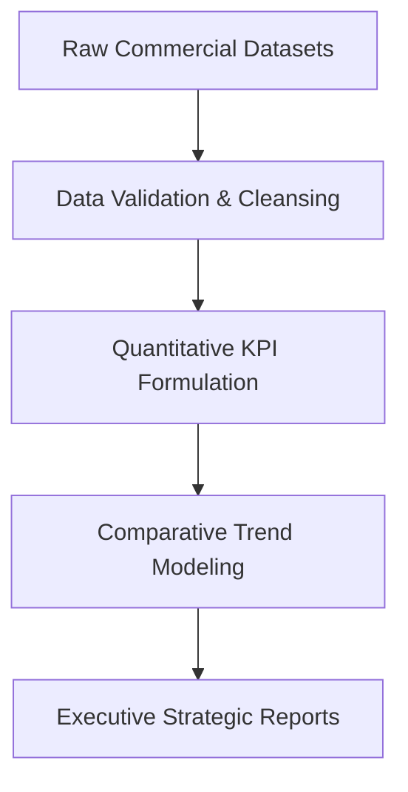

# 📊 Business Project Analysis — Empirical Business Modeling & Operations Intelligence

<p align="center">
  
</p>

<p align="center">
  <b>Quantitative Decision Science Framework: Formulating Empirical Business Models, Financial Metrics, and Operational Benchmarks.</b>
</p>

<p align="center">
  
  
  
  
</p>

<p align="center">
  
</p>

---

<a id="table-of-contents"></a>
## 📌 Table of Contents

- [📖 Executive Summary & Overview](#executive-summary--overview)
- [🎯 Key Features & Capabilities](#features)
- [🏗️ System Architecture & Pipeline](#system-architecture--pipeline)
- [🛠️ Tech Stack Breakdown](#tech-stack-breakdown)
- [⚙️ Reproducible Quickstart & Setup](#reproducible-quickstart--setup)
- [📁 Project Directory Layout](#project-directory-layout)
- [🔮 Future Improvements & Roadmap](#future-improvements--roadmap)
- [🤝 Contributing Guidelines](#contributing-guidelines)
- [👨‍💻 Author & Contributions](#author--contributions)

---

<a id="executive-summary--overview"></a>
## 📖 Executive Summary & Overview

Modern organizational leadership relies on data analytics to de-risk investments, streamline operations, and forecast supply-demand balances. Converting raw organizational records into strategic intelligence requires formal mathematical modeling, statistical significance testing, and clear visual reporting.

The **Business Project Analysis** repository anchors foundational research and analytical frameworks applied to organizational case studies across retail, logistics, and service operations at Alliance University.

---

<a id="key-features--capabilities"></a>
## 🎯 Key Features & Capabilities

### 📊 1. Quantitative KPI Modeling
- Formulation of operational margin formulas, inventory turnover indices, and customer acquisition costs.
- Risk modeling and variance tracking across seasonal commercial cycles.

### 🔄 2. Multi-Source ETL Frameworks
- Pipelines unifying ERP ledger extracts, point-of-sale logs, and customer feedback surveys into centralized data models.

---

<a id="system-architecture--pipeline"></a>
## 🏗️ System Architecture & Pipeline



---

<a id="tech-stack-breakdown"></a>
## 🛠️ Tech Stack Breakdown

| Dimension | Tooling / Technology | Role |
| :--- | :--- | :--- |
| **Analytics Environment** | Power BI Desktop, Microsoft Excel | Modeling, scenario analysis, and visualization |
| **Query Engine** | SQL & Power Query M | Relational data structuring and transformations |
| **Statistical Analysis** | Descriptive & Inferential Statistics | Variance estimation, distribution evaluation |

---

<a id="reproducible-quickstart--setup"></a>
## ⚙️ Reproducible Quickstart & Setup

```bash
# 1. Clone repository
git clone https://github.com/Amaraiah11/Business_Project_Analaysis.git
cd Business_Project_Analaysis

# 2. Inspect analytical models and documentation
```

---

<a id="project-directory-layout"></a>
## 📁 Project Directory Layout

```text
Business_Project_Analaysis/
└── README.md                  # Comprehensive architectural overview and documentation
```

---

<a id="future-improvements--roadmap"></a>
## 🔮 Future Improvements & Roadmap

- [ ] Add automated Python scripts for econometric regression analysis.
- [ ] Incorporate Monte Carlo simulation models for revenue risk bounds.

---

<a id="author--contributions"></a>
## 👨‍💻 Author & Contributions

This project is developed and maintained with rigorous engineering standards by **Amaraiah C**, Software Developer and Applied Data Analytics Practitioner studying Bachelor of Computer Applications (BCA) at Alliance University, Bangalore.

- 🌐 **GitHub Profile:** [@Amaraiah11](https://github.com/Amaraiah11)
- 💼 **LinkedIn Profile:** [Connect on LinkedIn](https://www.linkedin.com/in/amaraiah-c/)
- 📧 **Institutional Email:** `camaraiahBCA24@ced.alliance.edu.in`

### 🤝 Contributing Guidelines
Contributions, bug reports, and architectural discussions are welcome!
1. **Fork** the repository: `https://github.com/Amaraiah11/Business_Project_Analaysis`
2. **Create a Feature Branch:**
   ```bash
   git checkout -b feature/your-feature-name
   ```
3. **Commit Your Enhancements:**
   ```bash
   git commit -m "feat: enhance feature logic"
   ```
4. **Push to Your Branch:**
   ```bash
   git push origin feature/your-feature-name
   ```
5. **Open a Pull Request** against the `Amaraiah-C` branch.

---

<p align="center">
  <b>⭐ If this codebase or documentation assisted your engineering workflows, please star the repository! ⭐</b>
</p>

<p align="center">
  
</p>
