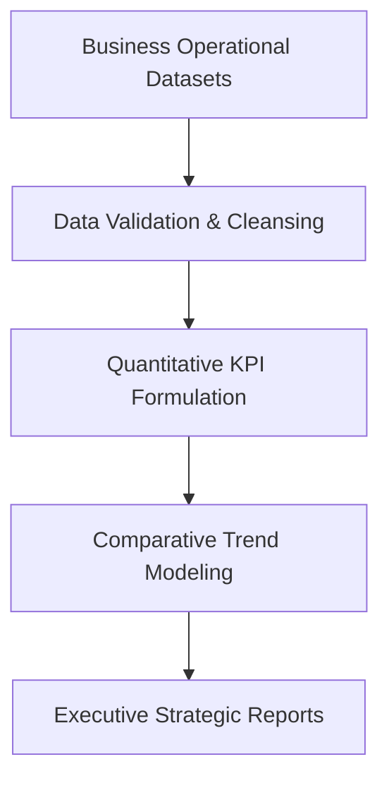

<p align="center">
  
</p>

<p align="center">
  
  
  
  
</p>

<a id="overview"></a>
## 📖 Executive Summary & Overview

Modern enterprises depend on data-driven decision engines to decode market volatility, supply chain dynamics, and consumer elasticity. The **Business Project Analysis** repository serves as a foundational analytical repository dedicated to empirical business analysis, quantitative research, and operational benchmarking.

This repository anchors analytical methodologies applied across organizational case studies, translating raw departmental records into actionable business strategic insights.

<a id="toc"></a>
## 📑 Table of Contents

- [📖 Executive Summary & Overview](#overview)
- [🎯 Key Features & Capabilities](#features)
- [🏗️ System Architecture & Pipeline](#architecture)
- [🛠️ Tech Stack Breakdown](#tech-stack)
- [⚙️ Reproducible Quickstart & Setup](#setup)
- [📁 Project Directory Layout](#project-layout)
- [👨‍💻 Author & Contributions](#author)

<a id="features"></a>
## 🎯 Key Features & Capabilities

- **Quantitative Business Modeling:** Implementation of key performance indicators (KPIs) to evaluate operational health and profitability.
- **Multi-Source Data Consolidation:** Strategies for combining transactional logs, financial summaries, and inventory balances.
- **Statistical Trend Forecasting:** Identifying growth trajectories, seasonal spikes, and customer retention metrics.
- **Decision-Support Reporting:** Providing structured reporting frameworks for stakeholders and executive leadership.

<a id="architecture"></a>
## 🏗️ System Architecture & Pipeline



<a id="tech-stack"></a>
## 🛠️ Tech Stack Breakdown

| Dimension | Tooling / Approach | Description |
| :--- | :--- | :--- |
| **Analytics Environment** | Power BI Desktop, Microsoft Excel | Business intelligence visualization & modeling |
| **Query Engine** | SQL & Power Query M | Relational data structuring and transformations |
| **Statistical Analysis** | Descriptive & Inferential Statistics | Distribution analysis, variance evaluation |
| **Documentation** | Structured Technical Reporting | Comprehensive metric definitions and findings |

<a id="setup"></a>
## ⚙️ Reproducible Quickstart & Setup

```bash
# 1. Clone the repository
git clone https://github.com/Amaraiah11/Business_Project_Analaysis.git
cd Business_Project_Analaysis

# 2. Explore documentation and analytical modules
```

<a id="project-layout"></a>
## 📁 Project Directory Layout

```text
Business_Project_Analaysis/
└── README.md              # Technical repository documentation & project scope
```

<a id="author"></a>
## 👨‍💻 Author & Contributions

This project is developed and maintained with high technical rigour by **Amaraiah C**, Software Engineer and Data Analytics Practitioner studying Bachelor of Computer Applications (BCA) at Alliance University.

- 🌐 **GitHub:** [@Amaraiah11](https://github.com/Amaraiah11)
- 💼 **LinkedIn:** [Connect on LinkedIn](https://www.linkedin.com/in/amaraiah-c/)
- 📧 **Institutional Contact:** `camaraiahBCA24@ced.alliance.edu.in`

### 🤝 Contribution Guidelines
Contributions, bug reports, and architectural discussions are welcome!
1. **Fork** the repository: `https://github.com/Amaraiah11/Business_Project_Analaysis`
2. **Branch**: `git checkout -b feature/your-feature-name`
3. **Commit**: `git commit -m "feat: enhance feature logic"`
4. **Push**: `git push origin feature/your-feature-name`
5. **Open Pull Request** against the `Amaraiah-C` branch.

---

<p align="center">
  <b>⭐ If this codebase or documentation assisted your engineering workflows, please star the repository! ⭐</b>
</p>

<p align="center">
  
</p>
